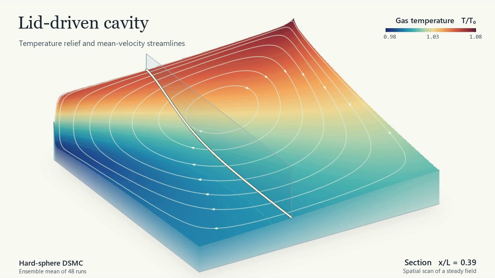

# Boltzmann-AI

Boltzmann-AI is Ehsan Roohi's research collection for rarefied gas dynamics. It brings together work on kinetic equations and learned models. Course materials are maintained in [FlowMLLab](https://github.com/Ehsan-Roohi/FlowMLLab).

The first version includes an equilibrium benchmark, an ideal-gas normal shock relation from FlowMLLab and a catalog of two studies. Each study links to its original publication.

## Research film

[](https://github.com/Ehsan-Roohi/Boltzmann-AI/raw/refs/heads/main/docs/assets/hero.mp4)

[Watch or download the film (MP4, 21 seconds)](https://github.com/Ehsan-Roohi/Boltzmann-AI/raw/refs/heads/main/docs/assets/hero.mp4). To view the research page offline, open [docs/index.html](docs/index.html) after downloading the repository.

The opening shot scans a steady lid-driven cavity field averaged over 48 independent DSMC runs. Surface height and color show the same normalized gas temperature. Streamlines trace the mean velocity. The second shot shows translational temperature in the computed upper half of a Mach 5 argon flow past a circular cylinder. The third shows a rotating atmospheric entry capsule concept. [Cavity research](https://github.com/Ehsan-Roohi/jfm-thermal-cavity-bgk-shakhov-dsmc) · [Cylinder study](https://doi.org/10.1063/5.0334590)

## Install and run

Use Python 3.10 or later. From the repository directory, run:

```sh
python -m pip install .
python -m boltzmann_ai maxwellian -2 -1 0 1 2
python -m boltzmann_ai publications
```

The installed command `boltzmann-ai` accepts the same arguments. The package uses the Python standard library at runtime.

## Equilibrium velocity distribution

For a gas at equilibrium, let `v` be one Cartesian component of molecular velocity, `u` the corresponding bulk velocity and `a = sqrt(k_B T / m)` its thermal standard deviation. The command accepts dimensionless values `c = (v - u) / a` and prints the probability density

```text
p(c) = exp(-c^2 / 2) / sqrt(2 pi).
```

The integral of `p(c)` over all real `c` is one. Its mean is zero and its variance is one. At `c = 0` the result is approximately 0.39894228. To recover a probability density per unit physical velocity, use `p(c) / a`. This is a one-component marginal. The three-dimensional speed distribution also includes the spherical volume factor.

## Normal shock end states

The function below predicts the downstream Mach number of a stationary plane normal shock in a calorically perfect gas. Use a finite upstream Mach number greater than one and a heat-capacity ratio greater than one (default 1.4). At Mach 2 with the default ratio it gives 0.57735027. It relates equilibrium conditions on opposite sides of the shock. Resolving the kinetic structure inside the shock requires a separate model.

```python
from boltzmann_ai.normal_shock import normal_shock_downstream_mach

print(normal_shock_downstream_mach(2.0))
```

The function and its default ratio are reproduced from [FlowMLLab at commit 385dc08](https://github.com/Ehsan-Roohi/FlowMLLab/blob/385dc08ef8fa1ceb3c1075d1ac7ef60d546cff38/flowmllab/gas_dynamics.py#L220-L228). Its [original MIT notice](third-party/FlowMLLab-LICENSE) accompanies the source and the wheel. That notice applies to the imported material.

## Research catalog

- **Kinetic PINNs and normal shocks.** Roohi's preprint compares predictions of steady planar shocks with independent kinetic reference solutions, including checks of higher-order moments. [arXiv preprint](https://arxiv.org/abs/2611.31996)
- **Neural closure for Fokker–Planck simulations.** Roohi's *Journal of Computational Physics* article evaluates a learned closure within a particle simulation. The internal-flow cases include planar Couette flow and a lid-driven cavity. [Journal article](https://doi.org/10.1016/j.jcp.2026.115261) · [Open preprint](https://arxiv.org/abs/2606.15622)

Related collaborative work on kinetic models of thermal cavity flows is maintained in the [BGK, Shakhov and DSMC cavity repository](https://github.com/Ehsan-Roohi/jfm-thermal-cavity-bgk-shakhov-dsmc).

## Adding research cases

The next candidates are the planar Couette verification case, the lid-driven cavity comparison and a one-dimensional normal-shock benchmark. For each imported case, record its originating publication or repository, version, contributors, redistribution terms, physical conditions and reference data. Keep the numerical inputs and units with the case so its results can be reproduced.
